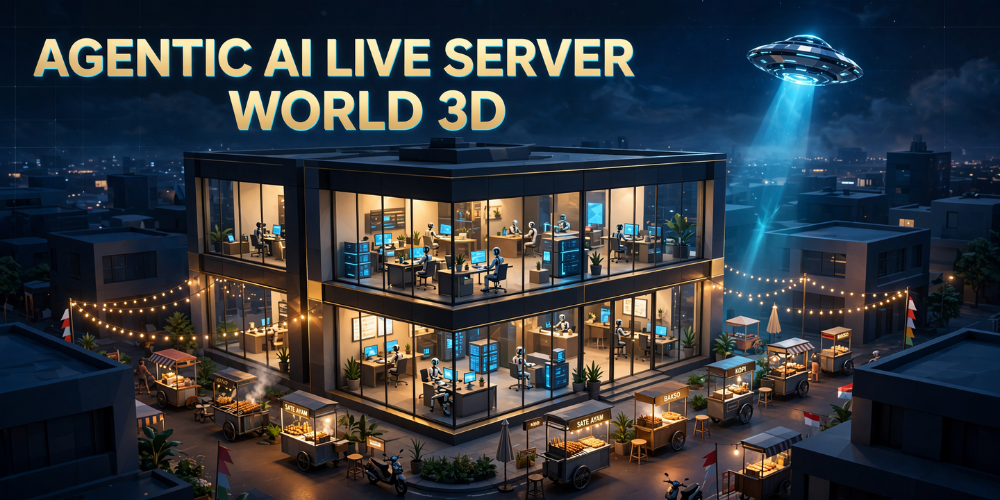
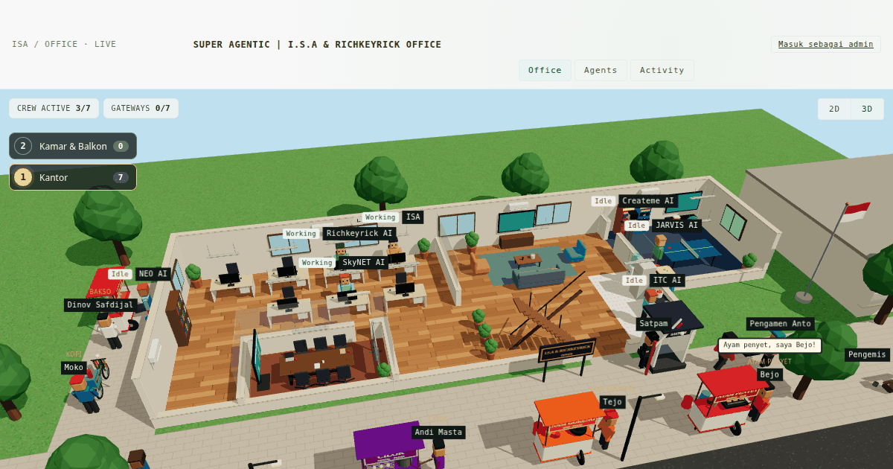
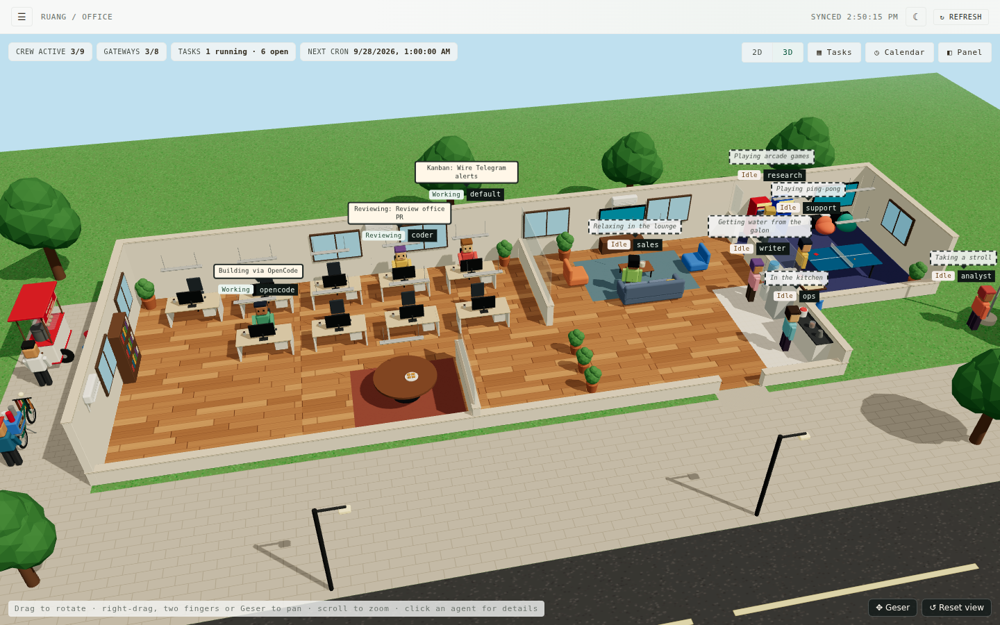
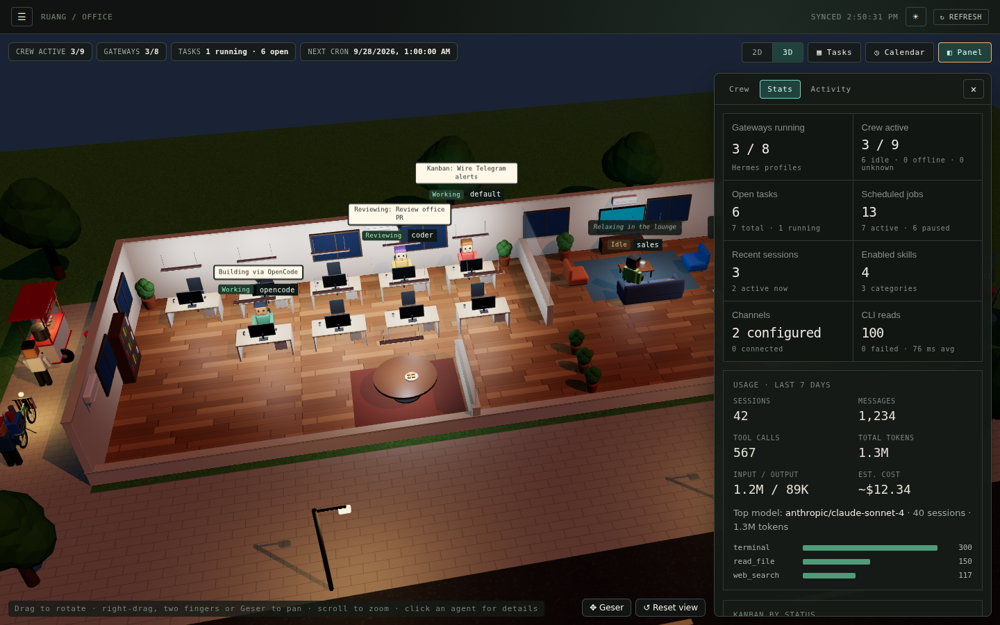
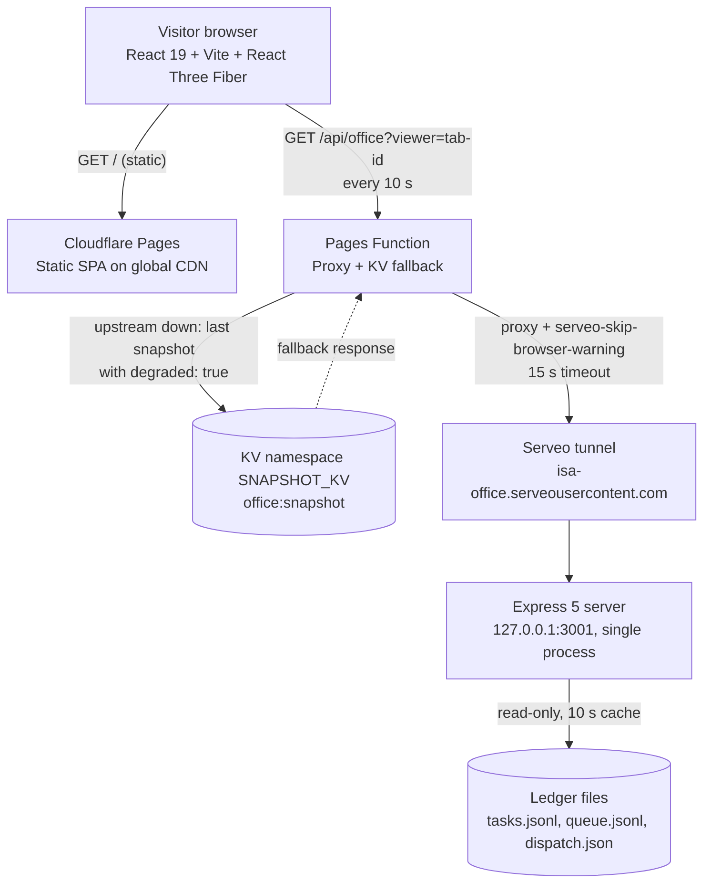
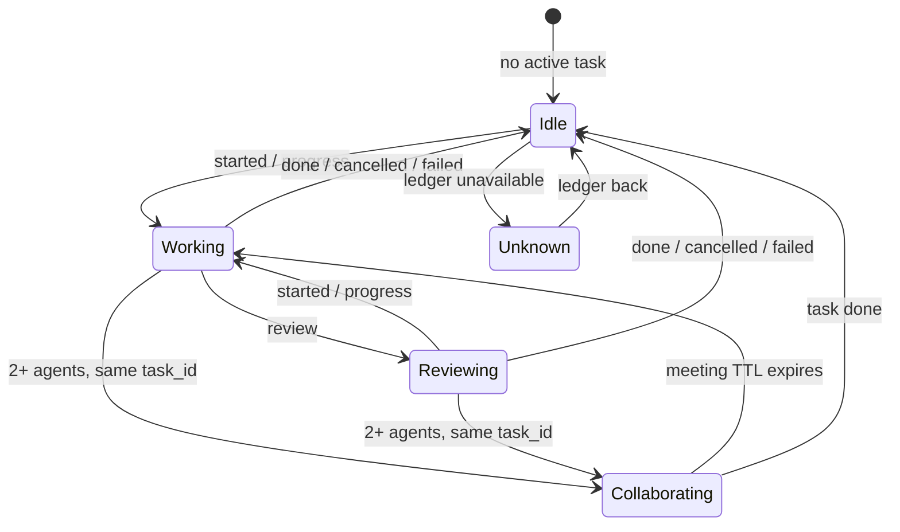
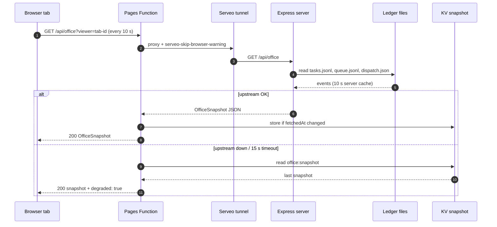
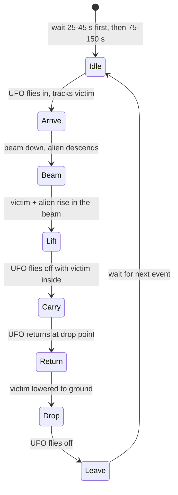

<p align="center">
  
</p>

<h1 align="center">
<!--
SEO Metadata: agentic AI, multi-agent, mission control, 3D virtual office, Three.js, React Three Fiber, virtual office, AI agents dashboard, realtime dashboard, live demo, Indonesia, open source, Express, Node.js, Cloudflare Pages, virtual world, AI crew, agent roster, task ledger, UFO, POV camera.
-->
  AGENTIC AI LIVE SERVER WORLD 3D
</h1>

<p align="center">
  <strong>A live 3D virtual office where 7 AI agents work in real time — a multi-agent mission control for agentic AI, rendered in Three.js.</strong>
</p>

<p align="center">
  
  
  
  
</p>

<p align="center">
  <a href="https://github.com/richkeyricks/agentic-world-3d/actions/workflows/ci.yml"></a>
  <a href="LICENSE"></a>
  = 20" />
  <a href="https://agentic-world-3d.pages.dev/"></a>
  <a href="https://agentic-world-3d.pages.dev/"></a>
</p>

<p align="center">
  <a href="https://agentic-world-3d.pages.dev/"></a>
  <a href="https://github.com/richkeyricks/agentic-world-3d/archive/refs/heads/main.zip"></a>
  <a href="docs/GETTING_STARTED.md"></a>
  <a href="https://richkeyrick.gumroad.com/l/agentic-world-3d-premium-pack"></a>
</p>

<p align="center">
  <a href="#live-demo">Live Demo</a> •
  <a href="#watch-the-office-in-action">Videos</a> •
  <a href="#screenshots">Screenshots</a> •
  <a href="#agent-roster">Agent Roster</a> •
  <a href="#architecture">Architecture</a> •
  <a href="#how-it-works--the-full-flow">How It Works</a> •
  <a href="#quick-start">Quick Start</a> •
  <a href="#features">Features</a> •
  <a href="#support-this-project--dukung-proyek-ini">Support</a>
</p>

Watch a crew of autonomous AI agents plan, build, review and ship work inside a living 3D world: a two-floor Indonesian office with a meeting room, lounge, game room and a street full of food carts, traffic and pedestrians — plus a UFO that occasionally abducts passers-by. Every Working / Idle state on screen is real data, not animation: the office reads a live task ledger and polls it every 10 seconds.

> **Live demo (primary):** <https://agentic-world-3d.pages.dev/> — fast, worldwide, no warning page. **Mirror:** <https://isa-office.serveousercontent.com/> (served through a tunnel; the first 3D load can take a few seconds). Open either link in any browser — no login needed for the public view.

> **Built and maintained by Richkeyrick.** **Mission Control ISA** is Richkeyrick’s rebuild of the 3D agent office. He replaced the `hermes` CLI data source with the ISA ledger (`tasks.jsonl` / `queue.jsonl` / `dispatch.json`), added the 7-agent ISA roster, the public view with access-code protection, the live viewer counter, POV mode, UFO events, the Indonesian street life, security hardening, and the Cloudflare Pages deployment — and he fixes and extends it continuously. The 3D office itself originates with [Hermes3D](https://github.com/iamlukethedev/Hermes3D) by Luke The Dev (August 2026) — the original 3D office for AI agents. This fork started from the later implementation [`yugienugraha/ruang`](https://github.com/yugienugraha/ruang) (Hermes Virtual Office), MIT — see [LICENSE](LICENSE). Upstream features that depend on the `hermes` CLI still work when it is present; without it they degrade to *Not Available* instead of failing.

## Live Demo

| | URL | Notes |
|---|---|---|
| **Primary (Cloudflare Pages)** | <https://agentic-world-3d.pages.dev/> | Static SPA on Cloudflare's global CDN — fast everywhere, no warning page. `/api/*` is proxied by a Pages Function to the live server (see [How it works](#how-it-works--the-full-flow)). |
| **Mirror (Serveo tunnel)** | <https://isa-office.serveousercontent.com/> | Direct tunnel to the VM. Same app, same live data — can be slower on first 3D load (free-tunnel bandwidth) and shows Serveo's interstitial warning page on first visit. |

What you see on the public link: the full 3D office, live — agents working, meeting bubbles, street life, the UFO. No account, no login. The header counter (`👁 N sedang menonton`) shows how many tabs are watching right now.

If the VM or tunnel is temporarily unreachable, the Cloudflare demo keeps serving the **last known snapshot** with a `degraded` flag instead of going blank — the office freezes on the last real state rather than inventing one.

📖 Docs: [Getting Started](docs/GETTING_STARTED.md) · [FAQ](docs/FAQ.md) · [Architecture](docs/ARCHITECTURE.md) · [Release Notes](RELEASE_NOTES.md)

## Watch the office in action

> **Start here — the full tour (5:15).** The long video below explains everything in detail: the office, the seven agents, how the ledger turns tasks into real work, and how to try it yourself. The two shorter videos underneath are the highlights.

The full tour is split into four parts so every part plays right here on this page — GitHub only shows an inline player for videos up to 10 MB. Audio is mastered to streaming standard (-14 LUFS, no clipping). If you watch one video, watch this one.

<p align="center">
  <a href="#part-1">● 1</a> &nbsp; <a href="#part-2">○ 2</a> &nbsp; <a href="#part-3">○ 3</a> &nbsp; <a href="#part-4">○ 4</a> &nbsp; <a href="#tour-84s">○ 5</a> &nbsp; <a href="#agents-68s">○ 6</a>
</p>

<a id="part-1"></a>

### 🎬 1 — Full tour, part 1: Hook & tour (1:45)

https://github.com/user-attachments/assets/48e74334-e1fb-4663-8112-97aa9b218ed4

The office from orbit — two floors, the meeting room, lounge, game room and the street outside — and all seven agents and their roles: ISA plans, Richkeyrick AI builds, and the rest of the crew.

<p align="center"><a href="#agents-68s">‹ Prev</a> &nbsp;·&nbsp; <a href="#part-2">Next ›</a></p>

<a id="part-2"></a>

### 🎬 2 — Full tour, part 2: The ledger (1:20)

https://github.com/user-attachments/assets/5d42c01c-75bd-4acd-b27f-6d5fe43220e5

The important part: how the task ledger turns tasks into real work. Every Working / Idle state comes from the real ledger — an agent only looks busy when it has a real task — and when two agents share a task, they meet and discuss it.

<p align="center"><a href="#part-1">‹ Prev</a> &nbsp;·&nbsp; <a href="#part-3">Next ›</a></p>

<a id="part-3"></a>

### 🎬 3 — Full tour, part 3: POV & install (1:40)

https://github.com/user-attachments/assets/9d401f58-15e6-416a-9a64-8a6b28071ec1

Watch the office through any agent's eyes with POV mode, see the street outside with its food carts and the UFO, and learn how to try the live demo free or run the office yourself.

<p align="center"><a href="#part-2">‹ Prev</a> &nbsp;·&nbsp; <a href="#part-4">Next ›</a></p>

<a id="part-4"></a>

### 🎬 4 — Full tour, part 4: Premium Pack (0:30)

https://github.com/user-attachments/assets/15d3c486-fa54-4023-b534-f61bead4b46b

The Premium Pack ($15): a ready-to-deploy build, a step-by-step setup guide, and priority support — for those who want a head start. The code in this repo stays free forever.
[💎 Get the Premium Pack — $15](https://richkeyrick.gumroad.com/l/agentic-world-3d-premium-pack) · [🚀 Try it live](https://office.richkeyrick.com/) · [⭐ Star this repo](https://github.com/richkeyricks/agentic-world-3d)

<p align="center"><a href="#part-3">‹ Prev</a> &nbsp;·&nbsp; <a href="#tour-84s">Next ›</a></p>

---

### More videos

<a id="tour-84s"></a>

### 🎬 5 — The 90-second tour (1:24)

https://github.com/user-attachments/assets/5a681825-339e-4cb6-ad69-78441cb316ee

A fast lap around the office: orbit, desks, the meeting room, floor two, the street, POV, and the UFO. Same footage as the long tour, cut to the essentials.

<p align="center"><a href="#part-4">‹ Prev</a> &nbsp;·&nbsp; <a href="#agents-68s">Next ›</a></p>

<a id="agents-68s"></a>

### 🎬 6 — Seven agents, working live (1:08)

https://github.com/user-attachments/assets/b05ba212-1a41-498c-ac77-caaab19ed33e

The proof the tour talks about: ISA plans, Richkeyrick AI builds, and every Working / Idle state comes from the real task ledger — an agent only looks busy when it has a real task.

<p align="center"><a href="#tour-84s">‹ Prev</a> &nbsp;·&nbsp; <a href="#part-1">Next ›</a></p>

> Like what you see? [⭐ Star this repo](https://github.com/richkeyricks/agentic-world-3d) — and if you want the ready-to-deploy build, setup guide, and priority support, get the [💎 Premium Pack — $15](https://richkeyrick.gumroad.com/l/agentic-world-3d-premium-pack).

## Screenshots

### The public office in daylight — the real ISA roster



The public office in daylight, exactly as the live demo shows it: ISA, Richkeyrick AI and SkyNET AI **Working**; NEO AI, Createme AI, JARVIS AI and ITC AI **Idle**. On the street are the named vendors — Dinov Safdijal (bakso), Moko (kopi), Tejo, Andi Masta and Bejo (ayam penyet) — plus the satpam, Pengamen Anto and the beggar. The floor switcher on the left shows 7 agents on floor 1 (*Kantor*). This image is also the site's Open Graph preview (`public/og-image.png`, 1200 × 630).

### The office floor — desks, lounge, game room



Daylight view of the office floor: hot desks, lounge, game room and kitchen, with each agent labelled by live state (*Working* / *Reviewing* / *Idle*) and current activity — "Building via OpenCode", "Reviewing: Review office PR", "Playing ping-pong", "Relaxing in the lounge". The header shows crew active, gateways, open tasks and the next cron. Screenshot taken against the upstream Hermes data source (note the Hermes profile names); the ISA build shows the same floor with the 7-agent ISA roster.

### Night mode with the Stats panel



Night mode with the Stats side panel open: gateways running, crew active, open tasks, scheduled jobs, recent sessions, enabled skills, channels, CLI reads and 7-day usage (sessions, messages, tool calls, tokens, estimated cost). The numbers shown come from the upstream Hermes data source — in ISA ledger mode the usage section reports *Not Available* until a token source is connected, instead of inventing numbers.

## Features

| | | |
|---|---|---|
| **🏢 Live 3D office**<br/>Two floors — office, meeting room, lounge, game room | **📒 Real ledger data**<br/>Every Working / Idle state comes from `tasks.jsonl`, polled every 10 s | **🛸 UFO abductions**<br/>A UFO beams pedestrians up 12.5 m and carries them away |
| **👁 POV mode**<br/>See the office through any agent's eyes | **👥 Live viewer counter**<br/>The header shows how many tabs are watching right now | **🛺 Indonesian street life**<br/>Bakso, cilok, kopi and ayam penyet carts with named vendors |

### The living 3D office

- **Two floors.** Floor 1 is the office: hot desks, a glass-walled meeting room, lounge, game room (ping-pong, arcade, carrom), pantry and split ACs. Floor 2 is the dorm: one bed per agent, a lesehan corner, bathroom and a ruko-style balcony with rattan chairs, a hammock and string lights.
- **Day / night.** Light mode is daytime; dark mode is evening — office lights, street lamps and cart lamps switch on, with a smooth ~2 s transition, fog, a gradient sky, dust / firefly particles and a waving Merah Putih flag.
- **Indonesian street life.** Bakso, cilok, nasi goreng, kopi keliling and ayam penyet carts with named vendors, a beggar, a busker (who sings), a security guard, cars and motorcycles on the road, market visitors, and **Ricky Market** — a supermarket next door that agents and pedestrians visit.
- **Ricky the promoter.** A gold-shirted promoter named Ricky walks the whole map — around every building, across the road, behind the office — carrying a `RICHKEYRICK / FOLLOW • SUBSCRIBE` board and cycling through promo bubbles.
- **UFO + alien.** Every so often a procedural UFO hovers over the street, lowers a blue beam, and abducts a pedestrian (or Ricky) — lifting them 12.5 m, carrying them away and dropping them somewhere else, after which they just keep walking.
- **Camera.** Orbit / zoom / pan, camera presets (Depan / Jalan / Pasar / Atas), a fly-through intro, on-screen rotate buttons, and two-finger twist-to-rotate on mobile. Auto-rotate pauses while you interact and resumes after 10 s idle. A 2D fallback is included for browsers without WebGL.

### Real work, shown honestly

- **7 agents, one roster.** ISA (Chief Orchestrator), Richkeyrick AI (Architect & Lead Engineer), NEO AI (Router / Intake), Createme AI (Creative Director), ITC AI (Research, Evidence & Executor), SkyNET AI (Verifier, Adversarial & Security) and JARVIS AI (Memory & Delivery). States are `Idle`, `Working`, `Reviewing`, `Collaborating` or `Unknown` — derived from the ledger, never faked. An agent with no task shows Idle.
- **Per-agent progress.** Tasks with an `estimated_minutes` value show a live % bar (elapsed ÷ estimate, capped at 99% until done).
- **Meeting dialogue.** When ISA and Richkeyrick AI collaborate on a task, they discuss it in speech bubbles — 2–3 exchanges per task, generated from the actual task being worked on.
- **POV mode.** Become any agent's eyes: pick a chip under the screen or click a character, and the camera follows them at eye height (standing / sitting / lying) as they walk, snack and climb the stairs. Esc or *Keluar dari POV* returns to the exact orbit view.
- **Live viewer counter.** The header shows how many tabs are watching right now (polled `/api/office` in the last 30 s, per-tab — no IPs, no cookies, no analytics).
- **Public vs admin.** Anyone opening the link sees the public, view-only office (floor buttons, 2D/3D, zoom/pan, POV and rotate all work; nothing can be changed). The admin dashboard — Tasks, Calendar, Logs, Settings, Usage, Memory, Folders — is protected by an **access code** (scrypt hash, `HttpOnly` cookie, 12 h sessions / 7-day remember-me, lockout backoff after 5 wrong tries). The server binds `127.0.0.1` only.
- **Dashboard pages.** Task Board (Kanban), Agents, Calendar (cron), Activity, Logs, Stats, Token Usage, Memory, Folders and Settings — all read-only. Pages whose source is unavailable render *Not Available* rather than invented data.

## Agent Roster

The roster lives in [`server/ledger.ts`](server/ledger.ts) (`ISA_ROSTER` — id, name, role, colour per agent). Edit it, rebuild, restart — the dorm beds, labels and POV chips follow the roster automatically.

| Agent | Role | Colour | States shown | Progress bar | Meeting dialogue |
|---|---|---|---|---|---|
| ISA | Chief Orchestrator | `#D8B36A` gold | Idle / Working / Reviewing / Collaborating / Unknown | Yes — when the task has `estimated_minutes` | Yes — planner side |
| Richkeyrick AI | Architect & Lead Engineer | `#7DD3FC` | Idle / Working / Reviewing / Collaborating / Unknown | Yes — when the task has `estimated_minutes` | Yes — implementer side |
| NEO AI | Router / Intake | `#60A5FA` | Idle / Working / Reviewing / Collaborating / Unknown | Yes — when the task has `estimated_minutes` | No |
| Createme AI | Creative Director | `#F472B6` | Idle / Working / Reviewing / Collaborating / Unknown | Yes — when the task has `estimated_minutes` | No |
| ITC AI | Research, Evidence & Executor | `#34D399` | Idle / Working / Reviewing / Collaborating / Unknown | Yes — when the task has `estimated_minutes` | No |
| SkyNET AI | Verifier, Adversarial & Security | `#F87171` | Idle / Working / Reviewing / Collaborating / Unknown | Yes — when the task has `estimated_minutes` | No |
| JARVIS AI | Memory & Delivery | `#E5E7EB` | Idle / Working / Reviewing / Collaborating / Unknown | Yes — when the task has `estimated_minutes` | No |

Every agent shows the same five states — the state machine is per-agent, not per-role. The meeting dialogue is only ever ISA ↔ Richkeyrick AI: the planner and the implementer discussing the task they collaborate on.

## Responsibility Matrix (RACI)

Who does what, by the SOP roster. **R** = Responsible (does the work), **A** = Accountable (owns the outcome, one per row), **C** = Consulted, **I** = Informed.

| Function | ISA | Richkeyrick AI | NEO AI | Createme AI | ITC AI | SkyNET AI | JARVIS AI |
|---|---|---|---|---|---|---|---|
| Plan & orchestrate | **A/R** | C | C | I | C | I | I |
| Build & implement | C | **A/R** | I | C | C | I | I |
| Creative direction | C | C | I | **A/R** | I | I | I |
| Research & evidence | C | C | I | I | **A/R** | C | I |
| Verify & security | I | I | I | I | C | **A/R** | I |
| Route & intake | C | I | **A/R** | I | I | I | I |
| Memory & delivery | C | I | I | I | I | I | **A/R** |
| Review work | **A** | C | I | I | I | **R** | I |

## Architecture



Key properties:

- **Read-only by design.** The server never writes to the ledger or to Hermes. The only writes in the whole app are its own optional access-code and profile-lock files.
- **No database.** State is a JSONL ledger on disk; snapshots are composed per request and cached for 10 s (server side).
- **Small surface.** One process, one port (`127.0.0.1:3001`), a handful of read endpoints; everything except `GET /api/office` and `GET /api/access` requires the access code.
- **Tested.** 275 tests (Vitest, 34 files) cover the ledger, the office state machine, the UFO state machine, POV maths, polling, viewers and the public/admin routing — run in CI on every push and PR.

Full component diagram, C4-style context, dependency and status matrices: [docs/ARCHITECTURE.md](docs/ARCHITECTURE.md).

## How it works — the full flow

Everything the office shows comes from one append-only file. Nothing is simulated, and nothing is faked when data is missing.

### 1. The ledger is the single source of truth

Work is recorded as events in `tasks.jsonl` — one JSON object per line:

```json
{"ts": "2026-11-17T10:25:00+07:00", "task_id": "mission-control-dialog-meeting", "agent": "isa", "title": "Dialog meeting ISA dan Richkeyrick AI per task", "status": "progress", "estimated_minutes": 45}
```

Event statuses are `created`, `queued`, `started`, `progress`, `review`, `blocked`, `done`, `failed`, `cancelled`. `queue.jsonl` holds work waiting to start; `dispatch.json` holds a single `{"paused": false}` flag. The server only ever **reads** these files — it never writes to them. The only files the server writes are its own access-code hash (`~/.config/ruang/access.json`) and profile-lock state.

### 2. Snapshot composition — from events to agent states

Every request to `GET /api/office` composes a fresh `OfficeSnapshot` (cached server-side for 10 s):

- **Agent state** is derived per agent from the latest event of their tasks: an active (`started` / `progress`) task means `Working`; `review` means `Reviewing`; anything else — including a finished task — means `Idle`. An agent with no attributed task is Idle. There is no "busy" animation without a task behind it.
- **Meetings.** When two or more agents share one active `task_id`, they are marked `Collaborating` (30 s TTL) and walk to the meeting area. While they collaborate, ISA (the planner) and Richkeyrick AI (the implementer) discuss the task in speech bubbles — 2–3 exchanges generated deterministically from the task title, cycling while the task runs; a new task gets a new set of exchanges.
- **Progress %.** A task with `estimated_minutes` shows `elapsed ÷ estimate`, rounded and **capped at 99%** while it runs — it only reads 100% when the `done` event actually arrives. A task re-opened after being done restarts its clock from the new start. A task with no estimate shows no bar at all: progress is never invented.
- **Viewer count.** Each tab generates a random id (`crypto.randomUUID()`, kept in `sessionStorage`) and sends it as `?viewer=<id>` on every poll. The server keeps an in-memory map of ids seen in the last 30 s and reports the count as `viewersNow`. No IPs, no cookies, no analytics, nothing stored to disk — a background tab drops out after ~30 s.



### 3. The request path — browser to ledger and back



If the upstream is unreachable, the Function serves the **last snapshot cached in KV** with `degraded: true` (written only when `fetchedAt` changes, to stay inside the free KV write quota). Any other API failure returns `{"error": "upstream_unavailable", "degraded": true}`. Static files never depend on the VM — only live data does.

### 4. Public vs admin — one URL, two doors

Routing is decided client-side from the URL (`src/entry-view.ts`):

- `/` or `?public=1` → the **public office**: view-only. Floor buttons, 2D/3D toggle, zoom/pan, rotate buttons, POV and the viewer counter all work; nothing can be changed and no admin page is reachable.
- `?admin=1` (or the "Masuk sebagai admin" link) → the **lock screen**, then the full dashboard after the access code.
- An unlocked device (cookie) goes straight to the admin dashboard.

Server-side, only `GET /api/office` and `GET /api/access` are open without the code. Everything else — tasks, calendar, logs, settings, usage, memory, folders — requires the `HttpOnly` session cookie. The code itself is stored only as a scrypt hash; the only unauthenticated write endpoint is `/api/access/unlock` (the login itself, with lockout backoff after 5 wrong attempts).

### 5. The living world — POV, traffic, UFO

- **POV mode.** A `PovCamera` follows the chosen agent's group every frame at eye height — 1.55 m standing, 1.1 m sitting, 0.75 m lying in bed — looking along their facing direction. Exiting (button or Esc) restores the exact orbit camera saved on entry.
- **Street life.** Vendors, pedestrians and traffic run on deterministic schedules in `src/street-life.ts` and `src/scene3d/`; agent snack stops and market visits are real idle-route stops, and the meeting dialogue and promoter bubbles are pure functions of `Date.now()` over fixed line sets.
- **UFO state machine** (`src/scene3d/ufo-state.ts`): `arrive → beam → lift → carry → return → drop → leave`. First event 25–45 s after load, then a 75–150 s gap. The victim (a market pedestrian or Ricky the promoter) is lifted to the UFO belly at 12.5 m, carried away and dropped ≥ 8 m from where they were taken, then resumes walking. Only people outdoors are taken — the beam never goes through a roof.



Phase lengths in code: arrive 4 s, beam 3.5 s, lift 3.5 s, carry 3 s, return 3.5 s, drop 3.5 s, leave 3 s. The beam is blue (`#2f7bff` outer cone, `#55d5ff` core) with a 1.6× opacity boost in daylight so it stays visible against the bright sky.

- **Day / night.** The `nightAmount` value lerps at 1.4/s (~2 s fade) and drives lights, fog, sky gradient, emissives and particles together — no instant switch.

## Specification

| Item | Value |
|---|---|
| Server bind | `127.0.0.1:3001` (localhost only, one process) |
| Node.js | ≥ 20 |
| UI poll | `GET /api/office` every 10 s (`?viewer=<tab id>`) |
| Server snapshot cache | 10 s (`?fresh=1` bypasses it when older than 2 s) |
| Viewer window | 30 s, in-memory, one entry per tab id |
| Meeting TTL | 30 s (2+ agents sharing one active `task_id`) |
| Pages Function upstream timeout | 15 s |
| KV snapshot write | Only when `fetchedAt` changes (free-tier quota: 1,000 writes/day) |
| Open endpoints (no code) | `GET /api/office`, `GET /api/access` |
| All other `/api/*` endpoints | Access code required (`HttpOnly` session cookie) |
| Admin session | 12 h (7 days with "remember this device") |
| Lockout | After 5 wrong access-code attempts |
| First UFO event | 25–45 s after load, then every 75–150 s |
| UFO lift height | 12.5 m to the UFO belly; drop ≥ 8 m from pickup |
| POV eye heights | 1.55 m standing, 1.1 m sitting, 0.75 m lying |
| 3D chunk | ~1 MB (loads in ~1 s on the Cloudflare demo) |
| Tests | 275 (Vitest, 34 files) — run in CI on every push and PR |
| License | MIT (fork of yugienugraha/ruang) |

## How This Compares

Archetypes, not specific products — what this project adds over the usual alternatives.

| Capability | This project | A plain status dashboard | A static 3D scene |
|---|:---:|:---:|:---:|
| Live agent states from a real ledger | ✅ | ✅ | ❌ |
| 3D world you can walk through (POV camera) | ✅ | ❌ | ✅ |
| Public view, no login | ✅ | Varies | ✅ |
| Meeting dialogue generated from real tasks | ✅ | ❌ | ❌ |
| Per-agent progress % (capped 99% until done) | ✅ | ✅ | ❌ |
| Street life, promoter, UFO | ✅ | ❌ | Decorative only |
| Admin dashboard behind an access code | ✅ | ✅ | ❌ |
| Self-hostable, MIT | ✅ | Varies | Varies |

## Tech Stack

| Layer | Technology |
|---|---|
| 3D / UI | React 19, Vite 7, React Three Fiber 9, three 0.186, TypeScript 5.9 |
| Server | Node.js ≥ 20, Express 5, TypeScript |
| Data | JSONL ledger (`tasks.jsonl`, `queue.jsonl`, `dispatch.json`) or Hermes CLI |
| Tests | Vitest 3, jsdom |
| CI | GitHub Actions (`npm ci` → lint → test → build) |

## Quick Start

Requires Node.js 20+.

```bash
git clone https://github.com/richkeyricks/agentic-world-3d.git
cd agentic-world-3d
npm install
npm run build      # builds the UI into dist/ and the server into build/server/
npm test           # 275 tests
npm start          # serves the app on http://127.0.0.1:3001
```

Open <http://127.0.0.1:3001> — the public office loads directly; use the **Admin** button (or `?admin=1`) and the access code for the full dashboard.

Development (hot reload, API + Vite dev server):

```bash
npm run dev        # API on 127.0.0.1:3001 + Vite UI (usually http://localhost:5173)
```

Other checks: `npm run lint`, `npm test`, `npm run build`. After pulling new code, run `npm install && npm run build` and restart the server (a running server keeps serving the old build).

## Configuration

| Variable | Default | Meaning |
|---|---|---|
| `ISA_LEDGER_DIR` | `~/workspace/mission-control-isa/data` | Directory holding `tasks.jsonl`, `queue.jsonl`, `dispatch.json`. Setting it selects ledger mode. |
| `RUANG_DATA_SOURCE` | auto | `ledger` forces ISA ledger mode; `hermes` forces Hermes CLI mode. |
| `RUANG_PORT` / `--port` | `3001` | Port to listen on. The server always binds `127.0.0.1`. |
| `RUANG_CONFIG_DIR` | `~/.config/ruang` | Where the access-code hash (`access.json`) and profile-lock file live. |
| `RUANG_HERMES_ROOT` | `~/.hermes` | Hermes root, only used in hermes mode. |

Access code (admin): enable it in **Settings → Access code** (or `ruang access-code new` on the machine). Only a scrypt hash is stored; the code itself is never saved or logged. Lost it? `ruang access-code off` removes it, then set a new one.

## Project Structure

```text
.
├── bin/ruang.js            # CLI entry point (start, access-code, profile-lock)
├── server/                 # Express server: ledger, office snapshot, access, viewers
│   ├── ledger.ts           # ISA ledger reader + office state machine
│   ├── index.ts            # HTTP server, routes, public-mode whitelist
│   └── access.ts           # access-code auth (scrypt, HttpOnly cookie, lockout)
├── src/                    # React app
│   ├── pages/              # Office, Office3D, Agents, TaskBoard, Calendar, …
│   ├── scene3d/            # 3D world: office, street life, traffic, UFO, POV
│   ├── office3d-layout.ts  # coordinates, floors, routes
│   └── polling.ts          # polling hooks (office: 10 s)
├── functions/api/          # Cloudflare Pages Function: /api/* proxy + KV fallback
├── public/                 # og-image.png (1200 × 630 social preview)
├── docs/                   # GETTING_STARTED.md, FAQ.md, ARCHITECTURE.md, screenshots/
├── assets/                 # repo-banner.png (README hero + social preview)
├── RELEASE_NOTES.md        # release notes (v1.0.0)
├── install.sh              # upstream installer (installs yugienugraha/ruang)
└── .github/                # workflows/ (CI + Release), ISSUE_TEMPLATE/, FUNDING.yml
```

## Support This Project — Dukung Proyek Ini

This project is free and open source (MIT). It is built and maintained by **Richkeyrick** in his spare time, and the live demo runs on a server he pays to keep alive. If this office made you smile, taught you something, or you just want it to stay online — a donation, any amount, genuinely helps keep the project (and its creator) going in difficult times. Thank you. 🙏

- ☕ **Saweria (Indonesia):** <https://saweria.co/richkeyrick>
- 💳 **PayPal (worldwide):** <https://www.paypal.com/donate/?business=richkeyrick@gmail.com&currency_code=USD> — or send directly to `richkeyrick@gmail.com`

You can also support for free: ⭐ star this repo, share the live demo, report a bug, or open a pull request.

## Premium Pack — $15 (optional, live now)

The code in this repo is free forever. For those who want a head start, the **Premium Pack ($15)** adds:

- A ready-to-deploy build (prebuilt `dist/` + server) — no build step
- A step-by-step setup guide (local run, Cloudflare Pages deploy, custom domain, access code)
- Priority support — direct help getting your own office live

This is an optional add-on; everything in this repository stays free and open source. Buy it here:

👉 **[Get the Premium Pack on Gumroad — $15](https://richkeyrick.gumroad.com/l/agentic-world-3d-premium-pack)**

Questions before buying? Ask on [WhatsApp +62 852-6011-3313](https://wa.me/6285260113313).

## Contributing

Contributions are welcome — see [CONTRIBUTING.md](CONTRIBUTING.md). In short: fork, branch off `main`, run `npm test` and `npm run build`, and open a pull request with a clear description and test notes. Good first issues are labelled `good first issue`.

## Security

Found a vulnerability? See [SECURITY.md](SECURITY.md) — please report it privately by email instead of opening a public issue.

## License

[MIT](LICENSE) © 2026 Richkeyrick and yugienugraha. Mission Control ISA is designed, rebuilt, hardened, and maintained by **Richkeyrick** — the ISA ledger engine, live agent states, public view with access-code security, viewer counter, POV mode, UFO events, and every fix and feature added since the fork. The 3D office originates with [Hermes3D](https://github.com/iamlukethedev/Hermes3D) by Luke The Dev (MIT, August 2026); the ruang code this fork started from remains © yugienugraha under the same MIT license. Contributions are accepted under the same license.

---

© Richkeyrick — <https://www.richkeyrick.com>
