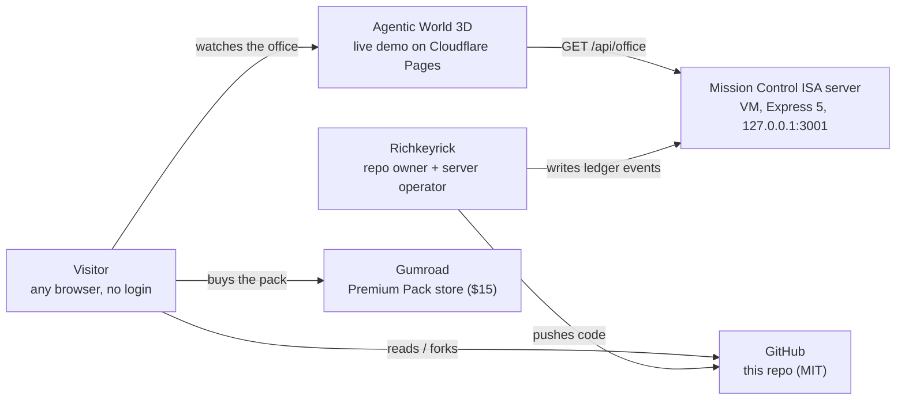
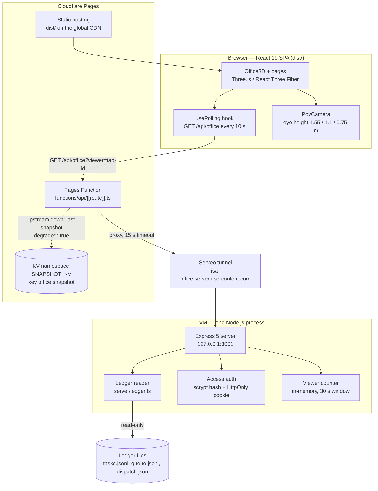
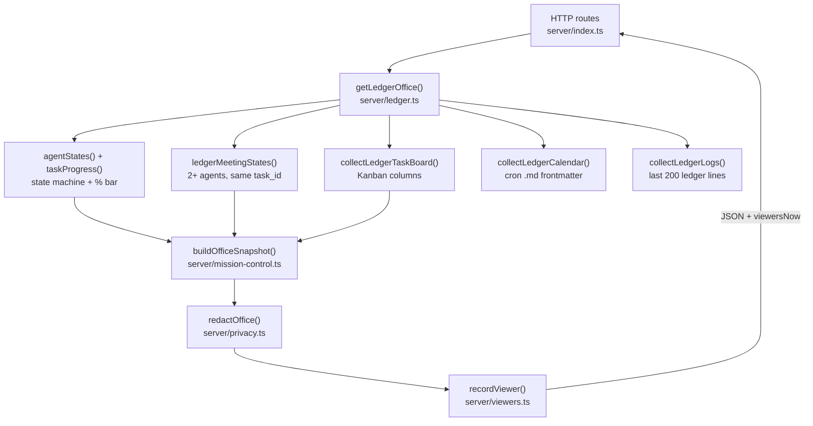

# Architecture

> Back to the [README](../README.md) — start there for the live demo, screenshots and quick start. This page is the technical reference: what each part is, what it depends on, and how data flows from a ledger event to a pixel on screen.

## System context (C4 level 1)



| Actor / system | What it does here | What it never does |
|---|---|---|
| Visitor | Watches the public office, rotates the camera, enters POV mode, counts as one viewer | Cannot change anything, cannot reach admin pages |
| Richkeyrick (operator) | Writes ledger events, sets the access code, keeps the VM + tunnel alive | Never appears as an agent in the office (the promoter "Ricky" is a separate scene character) |
| Cloudflare Pages | Serves the static SPA worldwide; the Pages Function proxies `/api/*` and serves the last KV snapshot when the upstream is down | Never writes to the ledger, never authenticates anyone |
| VM server | Composes `OfficeSnapshot` from the ledger, serves the SPA + API on `127.0.0.1:3001` | Never writes to the ledger; never exposes the VM to the internet directly |
| Gumroad | Sells the Premium Pack ($15) — prebuilt app, setup guide, priority support | Has nothing to do with the live demo or the repo |
| GitHub | Hosts this repo, runs CI, hosts Discussions | Not a runtime dependency — the demo runs without it |

## Containers (C4 level 2)



| Container | Technology | Responsibility | State it keeps |
|---|---|---|---|
| Browser SPA | React 19, Vite 7, R3F 9, three 0.186, TypeScript 5.9 | Renders the 3D office, polls the API, POV camera, themes | Per-tab viewer id (`sessionStorage`), theme choice, orbit camera |
| Cloudflare Pages | Pages + Pages Function (TypeScript) | Serves `dist/`; proxies `/api/*`; KV fallback for `/api/office` | Last snapshot in KV (only when `fetchedAt` changes) |
| Serveo tunnel | SSH tunnel, free tier | Exposes the localhost server to the internet | None |
| Express server | Node.js ≥ 20, Express 5 | Serves the SPA + API; composes snapshots; access auth; viewer counting | 10 s snapshot cache; viewer map (30 s); access-code hash; profile locks |
| Ledger files | JSONL on disk | The single source of truth for all work | Append-only events (`tasks.jsonl`), waiting work (`queue.jsonl`), pause flag (`dispatch.json`) |

## Component diagram — inside the server



The server is one process and one port. Every collector only reads; the only writes in the whole app are the server's own access-code hash and profile-lock files. Pages whose data source is missing render *Not Available* — the collectors return `availability: 'unavailable'` with an honest error instead of invented data.

## Data flow — ledger event to pixel

```
tasks.jsonl (append one JSON event per line)
  │  e.g. {"task_id": "x", "agent": "isa", "status": "progress", "estimated_minutes": 45}
  ▼
readTasks() — tolerant parse: a broken line is skipped, a missing file reads as empty
  ▼
agentStates() — per agent, per task: latest event decides
  │  started/progress → Working · review → Reviewing · else → Idle
  │  2+ agents on one active task_id → Collaborating (30 s TTL)
  ▼
agentProgress() — elapsed ÷ estimate, capped at 99% until the done event
  ▼
buildOfficeSnapshot() — stations + rooms + viewers + provenance, cached 10 s
  ▼
GET /api/office — public, no code; viewersNow attached per poll
  ▼
Pages Function — proxy to the VM (15 s timeout); KV fallback with degraded: true
  ▼
Browser poll (every 10 s) — React re-renders desks, labels, % bars, bubbles
```

Two facts the whole design hangs on:

1. **The ledger is append-only and the server is read-only.** Nothing the office shows can exist without a ledger event behind it — an agent with no task shows Idle, a task with no estimate shows no bar, a page with no source shows *Not Available*.
2. **The public snapshot carries no secrets.** Task titles are public (never put secrets in one), progress is a bare number, and the viewer counter is a count of random tab ids — no IPs, no cookies, no analytics.

## Dependency matrix

| Component | Depends on | Type | If the dependency is down |
|---|---|---|---|
| Browser SPA | Cloudflare CDN (`dist/`) | Hard | Page does not load at all |
| Browser SPA | Pages Function (`/api/*`) | Soft | Static office loads; live data shows the last snapshot or an error state |
| Pages Function | Serveo tunnel | Soft | Serves the last KV snapshot with `degraded: true` |
| Pages Function | KV namespace (`SNAPSHOT_KV`) | Soft | Returns `{"error": "upstream_unavailable", "degraded": true}` |
| Express server | Ledger files | Soft | Endpoints answer, pages render *Not Available* |
| Express server | Node.js ≥ 20, `express` | Hard | Server does not start |
| CI workflow | `npm ci`, Node 20, Vitest | Hard | PR/push checks fail |
| Release workflow | GitHub Releases, `gh` CLI | Soft | Release is not cut automatically |
| Docs / README | Nothing at runtime | — | — |

## Status matrix

Status is the honest state of each subsystem in the public demo. Owner is the SOP division that owns it.

| Subsystem | Status | Owner | Notes |
|---|---|---|---|
| 3D office render (public) | ✅ Live | Richkeyrick AI | Two floors, day/night, street life, UFO |
| Ledger → snapshot pipeline | ✅ Live | ISA | `tasks.jsonl` → `OfficeSnapshot`, 10 s cache |
| Public demo (Cloudflare Pages) | ✅ Live | ISA | Primary URL; KV fallback when the VM is down |
| Serveo tunnel mirror | ✅ Live (fallback) | SkyNET AI | Slower first load; warning page on first visit |
| Meeting dialogue | ✅ Live | ISA + Richkeyrick AI | 2–3 exchanges per task, from the real task |
| POV mode | ✅ Live | Richkeyrick AI | Eye heights 1.55 / 1.1 / 0.75 m |
| Viewer counter | ✅ Live | ISA | Per-tab ids, 30 s window, in-memory only |
| Access-code auth | ✅ Live | SkyNET AI | scrypt hash, `HttpOnly` cookie, lockout after 5 tries |
| Task Board / Calendar / Logs | ✅ Live | ISA | Read-only; cron from `.md` frontmatter |
| Token Usage | ⚠️ Not connected | JARVIS AI | Reports *Not Available* — no real token source yet |
| Memory / Folders | ⚠️ Depends on machine | JARVIS AI | Live when the agent folders exist, else *Not Available* |
| CI (test + build) | ✅ Live | Richkeyrick AI | Runs on every push and PR to `main` |
| Release workflow | ✅ Live | Richkeyrick AI | Cuts a GitHub Release on version tags |

## Security notes

- The server binds `127.0.0.1` only — it is never reachable directly from the internet, only through the tunnel and the Pages Function.
- Only `GET /api/office` and `GET /api/access` are open without the access code. The only unauthenticated write endpoint is `/api/access/unlock` (the login itself, with lockout backoff after 5 wrong attempts).
- Task titles are public — never put passwords, keys or other secrets in a task title.
- The access code is stored only as a scrypt hash (`~/.config/ruang/access.json`); the code itself is never saved or logged.
- See [SECURITY.md](../SECURITY.md) for how to report a vulnerability.
